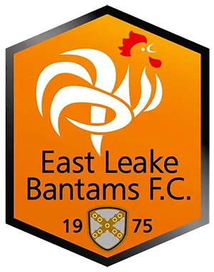
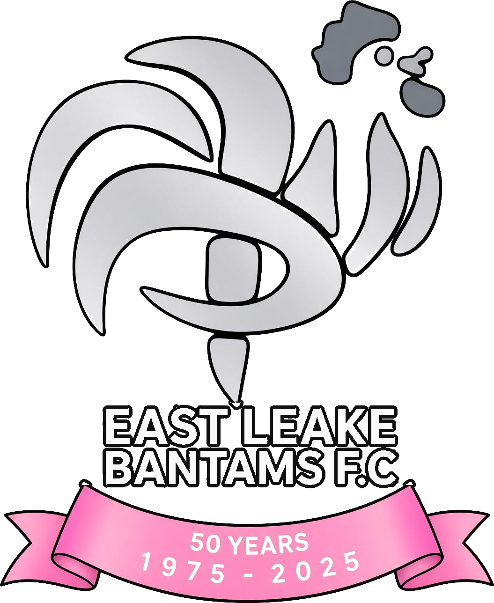
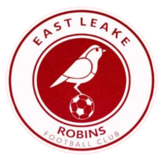

<a href="https://eastleakefc.co.uk">
  
  &nbsp;&nbsp;&nbsp;
  
  &nbsp;&nbsp;&nbsp;
  
</a>

# East Leake FC

**Grassroots football in East Leake, Nottinghamshire: the Bantams, the Ladies and the Robins.**

[Bantams](https://www.facebook.com/eastleakebantamsfc) ·
[Ladies](https://www.facebook.com/100094209904031/) ·
[Robins](https://www.facebook.com/p/East-Leake-Robins-Football-Club-61560046614439)

---

### What's here

This is where the club's volunteers build the club's digital tools. All of it is made for the club, by the club.

| Project | What it is |
| --- | --- |
| **website** | The public face of the club at [eastleakefc.co.uk](https://eastleakefc.co.uk). It's a holding page for now, and the full club site will replace it. |
| **training** | A coaching board for our coaches. Pick a principle or technique, such as *press*, *cover*, or *finishing*, and it shortlists matching drills from the club's library of 100+ sessions. Each drill has an editable pitch diagram and its coaching card. |

The repositories are private to club members. If you coach or volunteer with us and want access, ask a club admin.

### Getting involved

- **Players and parents:** the team pages above have fixtures, training times and news.
- **Coaches:** use the training board and say what's missing. New drills and corrections are always welcome.
- **Developers:** if you'd like to give some time to a local club, get in touch through any of the team pages.

 
Built on <a href="https://github.com/touchlineHQ/clubsPlatform">touchlineHQ/clubsPlatform</a> · React · TypeScript · Cloudflare

